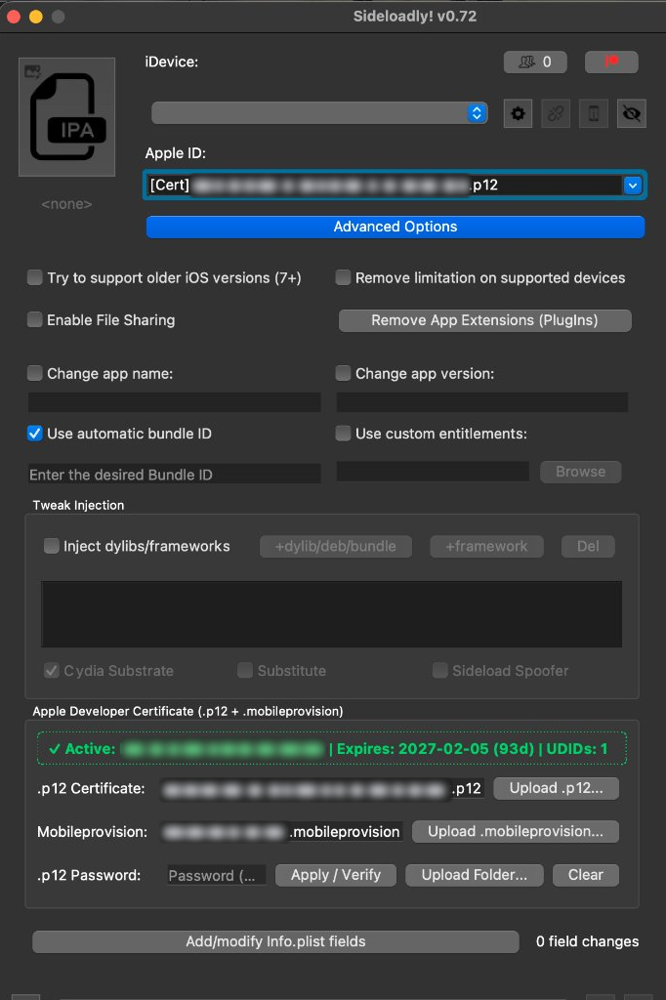
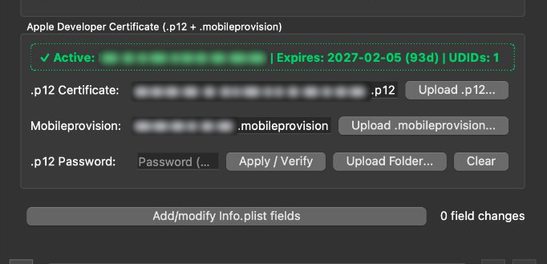

<div align="center">

# Sideloadly with Certificate Signing (`.p12` + `.mobileprovision`)

**Sign and install iOS apps in Sideloadly using your own Apple Developer Certificate — no Apple ID login, no 7-day expiry, no Anisette server required.**

[-007AFF?style=for-the-badge&logo=apple&logoColor=white)](https://github.com/timurabi3/Sideloady-with-cert-signing/releases/latest/download/Sideloadly-Cert-macOS.zip)
[](https://github.com/timurabi3/Sideloady-with-cert-signing/releases/latest)
[](https://github.com/timurabi3/Sideloady-with-cert-signing/releases/latest)

<br>



</div>

---

## Why This Exists

Standard Sideloadly requires logging in with an Apple ID and talking to Apple's developer portal via Anisette every time you sign an IPA. If you already have an **Apple Developer Certificate** (`.p12` + `.mobileprovision`) — whether from your own paid developer account or a certificate provider — there was no way to just drop your `.p12` and `.mobileprovision` into Sideloadly and sign offline.

This mod adds a native **Apple Developer Certificate (`.p12` + `.mobileprovision`)** panel directly inside Sideloadly's **Advanced Options**:

<div align="center">

</div>

- **Drag & Drop or Upload**: Drop your `.p12` and `.mobileprovision` files right into the panel (or click **Upload `.p12...`** / **Upload `.mobileprovision...`**).
- **Auto Password Detection**: Type your `.p12` password and click **Apply / Verify**, or keep a `PASSWORD.txt` in the same folder as your `.p12` and it unlocks automatically.
- **Zero Apple ID Login**: Selects your `[Cert] ... .p12` profile in the **Apple ID** dropdown and signs locally through Sideloadly's native `signpipe` installer (USB, Wi-Fi, or Export IPA) without ever asking for an Apple ID password.
- **Full Entitlements & 1-Year Validity**: Preserves your provisioning profile's full validity period and entitlements without free-account 7-day bundle ID mangling.

---

## Download & Install (`.app`)

### Option 1 — Download Ready-to-Use `.app` (Recommended)

1. [**Download `Sideloadly-Cert-macOS.zip` from Releases**](https://github.com/timurabi3/Sideloady-with-cert-signing/releases/latest/download/Sideloadly-Cert-macOS.zip).
2. Unzip it and drag **`Sideloadly-Cert.app`** into `/Applications`.
3. If macOS Gatekeeper asks on first launch, run this once in Terminal:
   ```bash
   xattr -cr /Applications/Sideloadly-Cert.app
   open /Applications/Sideloadly-Cert.app
   ```

### Option 2 — Patch Your Existing `Sideloadly.app`

If you already have `/Applications/Sideloadly.app` installed and want to build the patched `.app` yourself:

```bash
git clone https://github.com/timurabi3/Sideloady-with-cert-signing.git
cd Sideloady-with-cert-signing

./bin/sideloadly-cert-patcher \
  --source /Applications/Sideloadly.app \
  --output /Applications/Sideloadly-Cert.app
```

---

## How to Sign an IPA with Your Certificate

1. Open **`Sideloadly-Cert.app`** and click **Advanced Options**.
2. Scroll down to **Apple Developer Certificate (`.p12` + `.mobileprovision`)**:
   - **Drag and drop** your `.p12` and `.mobileprovision` files into the box (together, one by one, or as a folder), **or**
   - Click **Upload `.p12...`** and **Upload `.mobileprovision...`**.
3. Enter your `.p12` password in **.p12 Password** and click **Apply / Verify** (if you have a `PASSWORD.txt` next to your `.p12`, it is picked up automatically).
4. Once the status bar turns green (`✓ Active: ... | Expires: ...`), drop your `.ipa` into Sideloadly and click **Start**.

---

## Command-Line Signer (Optional)

You can also sign IPAs directly from the terminal using either Sideloadly's internal signing engine or `zsign`:

```bash
# Inspect a certificate folder (.p12 + .mobileprovision + optional PASSWORD.txt)
./bin/sideloadly-cert-sign inspect --cert-dir "/path/to/cert-folder"

# Sign an IPA offline
./bin/sideloadly-cert-sign sign \
  --ipa MyApp.ipa \
  --output MyApp-Signed.ipa \
  --cert-dir "/path/to/cert-folder"
```

---

## Project Layout

- `src/sideloadly_dylib_proxy.mm` — Objective-C++ & Qt5 dylib proxy (`Frameworks/sideloadly.dylib`) that injects the **Apple Developer Certificate** panel into Sideloadly's **Advanced Options** UI.
- `src/sideloadly_cert_hook.py` — In-process Python hook for `sideloadly.wrap.accounts` and `sideloadly.wrap.run` driving `GuiImpactor` offline with local `.p12` + `.mobileprovision` credentials.
- `bin/sideloadly-cert-patcher` — Builds and ad-hoc signs `Sideloadly-Cert.app` from `/Applications/Sideloadly.app`.
- `bin/sideloadly-cert-sign` — Standalone CLI for certificate inspection and IPA signing.
